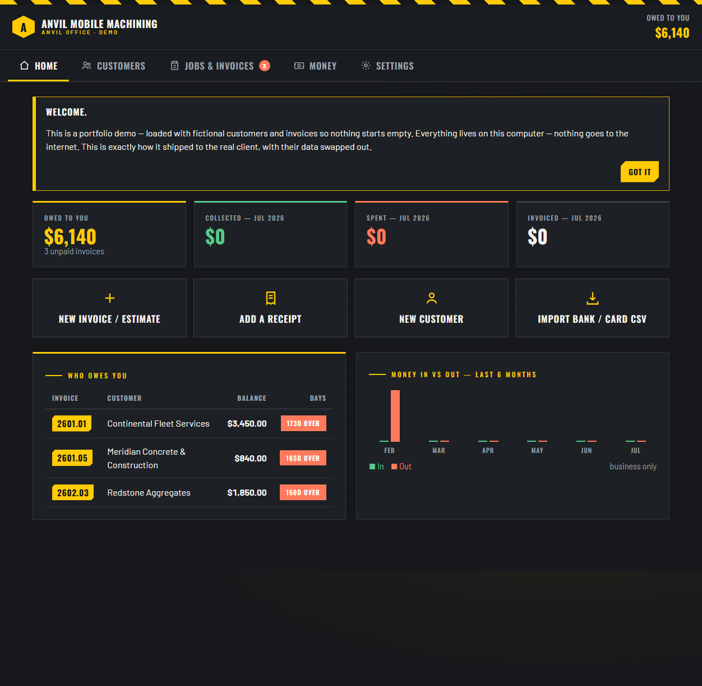
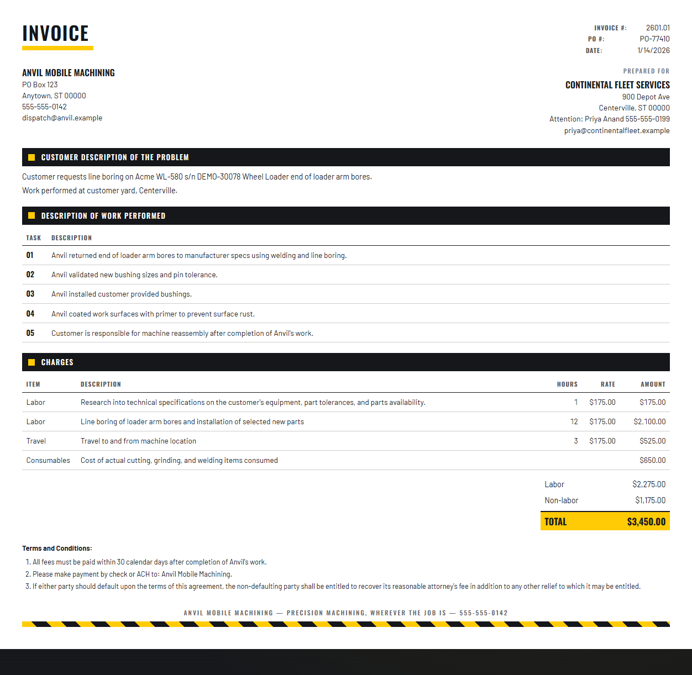
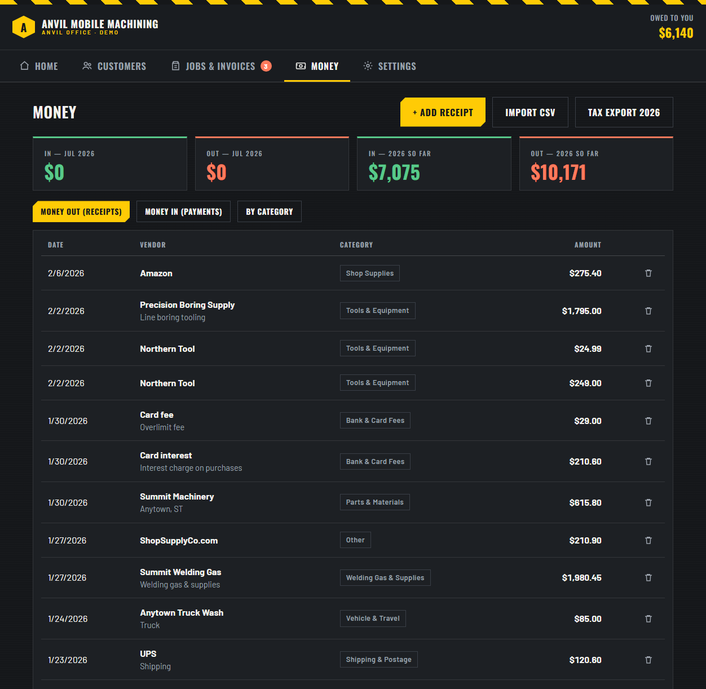
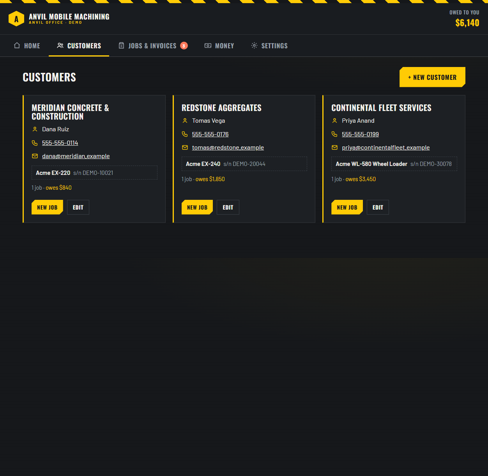
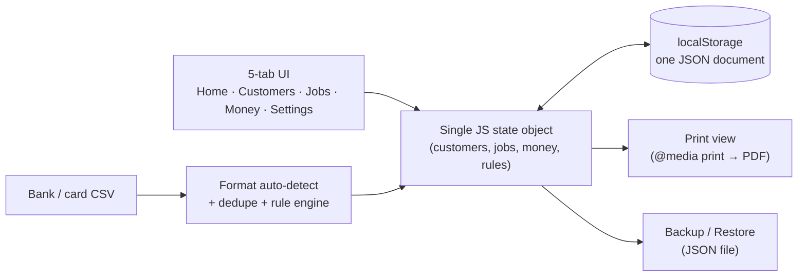

# Anvil Office — Field-Service Business App

> **A single-file CRM, invoice generator, and receipt tracker built for a non-technical
> small-business owner** — zero install, zero login, zero monthly fee, works fully offline.

This repository is a sanitized portfolio copy of a real DataMind Consulting client deliverable:
a mobile heavy-equipment machining shop with one truck, one owner, and zero appetite for
software. The brief was blunt — *"anything with a login won't get used."* This is what shipped.

> **This is a demo, not a template.** "Anvil Mobile Machining" is a fictional company, and all
> data in this repository is invented: every customer, contact, address, phone number, email,
> machine, serial number, invoice, bank/card transaction, and dollar figure, in both the app's
> seed data and the screenshots. National chains appear only as example vendor names. The
> architecture, UI, and workflow are exactly what the real client received.

---

## Live demo

Open [`Anvil-Office.html`](Anvil-Office.html) directly — download the file and double-click it,
or [view it running on GitHub Pages](https://datamindbi.github.io/datamind-fieldservice-suite/Anvil-Office.html).
No build step, no server. It's one HTML file.

## What this demonstrates

- **Designing for the actual user, not the ideal user.** No accounts, no cloud sync, no jargon —
  because the owner it was built for wasn't going to tolerate any of those. Big touch targets,
  plain-language copy, a five-tab layout that maps to how he already thinks about his business
  (customers → jobs → money).
- **A print-perfect business document from a data model.** The invoice/estimate view
  ([screenshot below](#the-invoice)) reproduces the client's existing Excel invoice layout
  pixel-for-pixel from structured data — same numbering scheme, same terms language, same
  Labor/Non-labor split — so switching tools didn't change what his customers received.
- **Real bank/credit-card statement reconciliation**, not a toy import. The CSV importer
  auto-detects two real-world statement formats, classifies each line (income / expense /
  transfer-skip / already-imported), and applies editable vendor→category rules — built and
  tested against the client's actual statement exports.
- **An offline-first architecture that's still a real app.** One HTML file, vanilla JS, a single
  `localStorage` document as the data model, JSON export/import as the entire backup story. No
  framework, no build tool, no dependency to go stale.

## Screenshots

**The invoice — print-ready, matches the client's original Excel layout:**

**Receipt tracker with category breakdown:**

**Customer records with equipment/serial tracking:**

## How it's put together

- **No backend.** The "database" is one `localStorage` key; the "API" is a handful of pure JS
  functions (`save()`, `render()`, `jobTotal()`, `applyRules()`...).
- **No build step.** Everything — markup, styles, logic — lives in one HTML file so it can be
  emailed, put on a USB stick, or dropped on any static host unchanged.
- **CSV import is a small state machine, not a one-shot parser**: parse → classify (income /
  transfer-skip / dedupe-against-existing) → human review in a checklist UI → commit. Nothing is
  written until the owner confirms it.
- **Print and screen share one data model.** The on-screen editor and the print-only invoice
  template both read the same job record — there's no separate "generate PDF" step to keep in
  sync.

## What shipped alongside the app

- An **owner's guide** ([`OWNER-GUIDE.html`](OWNER-GUIDE.html)) — a printable, plain-language
  one-pager, because a README is not documentation for this user.
- A short verification pass in a real browser (Playwright) before delivery: seed data loads,
  invoice totals match the original spreadsheets to the cent, CSV re-import correctly flags
  every row as a duplicate, recording a payment flips an invoice to Paid, backup/restore
  round-trips.

## Limitations (stated, not hidden)

- Single-device by design — data lives in that browser's `localStorage`. Backup/restore JSON is
  the sync mechanism, not real-time multi-device.
- No email sending, no online payments, no accounting-package export. Scope was deliberately
  narrow: replace a folder of loose Excel files, not build QuickBooks.

---

Built by **[DataMind Consulting](https://datamindbi.com)** — Power BI, data engineering, ML, and
practical software delivery for lean operators. kenny@datamindbi.com
